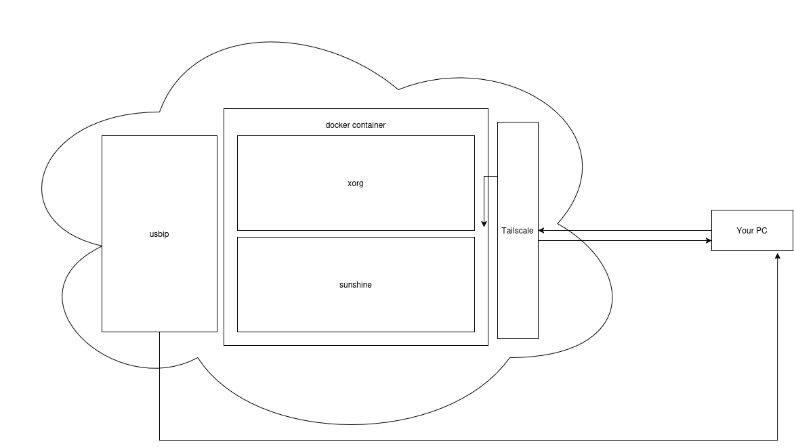

# ☁️ Cloud Gaming with Custom Peripherals

Welcome! This project provides a containerized cloud gaming environment (using Sunshine, Openbox, and Steam) specifically designed to support "strange" or specialized USB peripherals over the internet. 

If you've ever tried to play a simulator in the cloud using a custom controller—like a RadioMaster drone remote, a specialized racing wheel, or a flight stick—you know that standard game streaming apps often fail to recognize them. This project solves that by bridging your local USB device directly into the remote cloud server's kernel, making the remote server think the device is physically plugged into it.

## 🏗️ Architecture



**How it works:**
1. **Local PC:** Uses `usbip` to intercept your specialized peripheral (like a drone remote) and serve it over the network.
2. **Network:** Tailscale creates a secure, low-latency VPN tunnel between your home PC and the cloud server.
3. **Cloud Server:** Uses the `vhci-hcd` kernel module to catch the USB stream and inject it into `/dev/input/`.
4. **Docker Container:** A fully isolated, GPU-accelerated environment runs Sunshine and Steam, with direct access to the injected input devices and NVIDIA hardware.

---

## 💻 1. Local PC Setup (The Sender)

First, we need to bind your local USB peripheral so it can be shared over the network. Run these commands on the Linux PC where your controller is physically plugged in.

```bash
# 1. Load the USB/IP host module
sudo modprobe usbip_host

# 2. Restart the USB/IP daemon to ensure a clean slate
sudo killall usbipd
sudo usbipd -D

# 3. Find your device's Bus ID (look for your controller in the output)
usbip list -l

# 4. Unbind and Rebind the specific device (Replace '3-3' with your actual Bus ID)
sudo usbip unbind -b 3-3
sudo usbip bind -b 3-3
```
*Note: Keep Tailscale running on your local PC so the cloud server can reach it!*

---

## ☁️ 2. Cloud Server Setup (The Receiver)

Run these commands on your remote server (e.g., Ubuntu/Debian) to prepare the environment, install GPU drivers, and set up the virtual USB receivers.

### A. Network & Kernel Preparation
```bash
# Install and start Tailscale to connect to your local PC
curl -fsSL [https://tailscale.com/install.sh](https://tailscale.com/install.sh) | sh
sudo tailscale up

# Install extra kernel modules required for virtual USBs and inputs
sudo apt install -y linux-modules-extra-$(uname -r)

# Load the required modules
sudo modprobe uinput
sudo modprobe vhci-hcd

# Grant read/write permissions to input devices so Docker can read them
sudo chmod 666 /dev/input/*
```

### B. Docker & NVIDIA Toolkit Installation
```bash
# Clean up old Docker repos
sudo rm /etc/apt/sources.list.d/*docker*.list /etc/apt/sources.list.d/*docker*.sources 2>/dev/null

# Add Docker's official GPG key and repository
echo "deb [arch=$(dpkg --print-architecture) signed-by=/etc/apt/keyrings/docker.asc] [https://download.docker.com/linux/ubuntu](https://download.docker.com/linux/ubuntu) $(. /etc/os-release && echo "$VERSION_CODENAME") stable" | sudo tee /etc/apt/sources.list.d/docker.list > /dev/null

# Install Docker (Assuming standard apt-get install docker-ce docker-ce-cli containerd.io)
sudo apt-get update && sudo apt-get install -y docker-ce docker-ce-cli containerd.io

# Add NVIDIA Container Toolkit repository
curl -fsSL [https://nvidia.github.io/libnvidia-container/gpgkey](https://nvidia.github.io/libnvidia-container/gpgkey) | sudo gpg --dearmor -o /usr/share/keyrings/nvidia-container-toolkit-keyring.gpg
curl -s -L [https://nvidia.github.io/libnvidia-container/stable/deb/nvidia-container-toolkit.list](https://nvidia.github.io/libnvidia-container/stable/deb/nvidia-container-toolkit.list) | \
  sed 's#deb https://#deb [signed-by=/usr/share/keyrings/nvidia-container-toolkit-keyring.gpg] https://#g' | \
  sudo tee /etc/apt/sources.list.d/nvidia-container-toolkit.list

# Install and configure NVIDIA runtime
sudo apt-get update
sudo apt-get install -y nvidia-container-toolkit
sudo nvidia-ctk runtime configure --runtime=docker
sudo systemctl restart docker
```

---

## 🚀 3. Build & Run the Environment

With the host server configured and your local device broadcasting, it's time to build and start the cloud gaming container.

```bash
# Build the Docker image
docker build -t sunshine-cloud .

# Run the container with GPU and Device passthrough
docker run \
  --name sunshine \
  --gpus all \
  --network host \
  --privileged \
  --env-file .env \
  -e NVIDIA_DRIVER_CAPABILITIES=all \
  -e NVIDIA_VISIBLE_DEVICES=all \
  -v /dev:/dev \
  -v /usr/lib/linux-tools:/usr/lib/linux-tools:ro \
  sunshine-cloud
```

Once running, connect to Sunshine using Moonlight from any device, and your custom controller will be recognized natively inside the cloud server!
